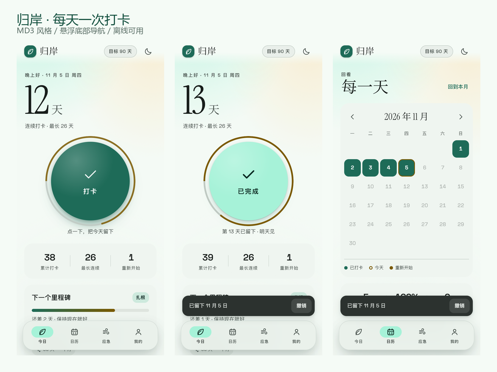

# 归岸 · 自律打卡

> 每天一次打卡，把自己带回岸上。

一个纯静态、零依赖、完全离线的打卡应用。名字取「回头是岸」的岸：不评判、不催促，只负责把每一天留下来。

**安卓安装包**：[`guian-1.0.apk`](https://github.com/YUI1314520/guian/releases/download/v1.0/guian-1.0.apk)（298 KB，Android 5.0+，不需要联网）　**网页版**：双击 `index.html` 就能跑



---

## 打开方式

**方式一（最简单）：双击 `index.html`。** 字体已内嵌，断网也能用，数据存在浏览器 localStorage 里。

**方式二（可安装为桌面 / 手机 App）：**

```bash
cd F:\Deepseek\jiese
py serve.py 8765
```

然后访问 <http://127.0.0.1:8765/index.html>，Chrome 地址栏会出现「安装」按钮，装好后就是一个独立窗口的 App，可全屏、可离线。

> 必须用 `serve.py` 而不是 `py -m http.server`：Windows 注册表常把 `.js` 的 MIME 记成 `text/plain`，会导致 Service Worker 注册失败。真实静态托管（GitHub Pages / Netlify / Vercel）没有这个问题。

---

## 打卡是这个 App 的核心

| 能力 | 说明 |
| --- | --- |
| 一键打卡 | 今日页中央 208px 圆钮，点一下即完成；带涟漪、环形进度与触感反馈 |
| 即时撤销 | 打卡后底部弹出提示条，5 秒内可撤销 |
| 连续天数 | 从今天（未打卡则从昨天）往回数，遇到空档或上一次「重新开始」当天截止 |
| 历史最长 | 逐日遍历，遇到复发日重新起算，不会把破戒前的天数算进新纪录 |
| 补记 | 日历页点亮过去的某一格即可补记，再点一次撤销 |
| 破戒重置 | 「我破戒了 · 重新开始」→ 选触发场景 → 连续天数归零、重启次数 +1；当天若继续打卡，从第 1 天算起 |
| 里程碑 | 1 / 3 / 7 / 14 / 21 / 30 / 45 / 60 / 90 / 120 / 180 / 365 天，共 12 枚徽章 |
| 统计 | 累计打卡、最长连续、重新开始次数；日历页另有本月打卡数、打卡率、本月重启 |

## 另外三个页面

- **日历**：月视图，已打卡 / 今天 / 重新开始三种状态，可翻月、可回本月、可补记。
- **应急**：4-4-6 呼吸（90 秒 6 轮，带光晕缩放）、延迟 10 分钟计时（离开页面也继续走，回来接着倒数）、五件「现在就做的小事」、写下此刻（只存本机）、最近写下的话。
- **我的**：目标天数（30/60/90/120/180/365/1000）、12 枚里程碑、跟随系统 / 浅色 / 深色、导出与导入 JSON 备份、清空数据。

---

## 设计说明（Material Design 3）

- **色**：以 MD3 tonal palette 组织语义 token，主色是深绿玉石 `#1E6B58`，容器色 `#A6F2D8`，第三色暖沙 `#7A5900`；表面 `#F5FBF6`。深色主题单独一套（主色 `#8AD5BC`、表面 `#0D1512`），不是简单反色。
- **形**：卡片 22px、弹窗 28px、按钮全圆角，遵循 MD3 的 shape scale；选中态用 tonal 填充而不是描边。
- **字**：Instrument Serif 承担大数字与标题（104px 的连续天数），Space Grotesk 承担拉丁字母与数字，中文回退到 PingFang SC / HarmonyOS Sans / MiSans / Noto Sans SC。三种字体全部内嵌为 base64，`file://` 下也不会掉字体。
- **动**：`cubic-bezier(0.16, 1, 0.3, 1)` 的进场；打卡环、呼吸光晕、涟漪都尊重 `prefers-reduced-motion`。
- **无障碍**：正文对比度 16.3:1、辅助文字 8.4:1、深色模式 10.9:1；所有可点元素 ≥ 44px；焦点可见；`aria-pressed` / `aria-live` / `role="grid"` 齐备。

---

## 文件结构

```
jiese/
├── index.html                 4 个视图 + 浮动 NavigationBar + 内联 SVG 图标
├── assets/
│   ├── styles.css             MD3 token、组件、明暗主题、动效（字体已内嵌）
│   ├── app.js                 状态、日期推算、渲染、交互、导入导出
│   ├── icon.svg               应用图标
│   ├── icon-maskable.svg      自适应图标
│   └── fonts/                 三个 woff2 源文件（CSS 中已 base64 内嵌）
├── manifest.webmanifest       PWA 清单
├── sw.js                      Service Worker，cache-first 离线缓存
├── serve.py                   本地预览服务器（修正 MIME）
├── preview/                   界面截图
└── .tests/                    Playwright 回归脚本
```

## 数据与隐私

- 全部数据在 `localStorage` 的一个 key 里（`guian.v1`），不上传、不统计、不联网。
- 清浏览器数据 / 换设备前，请在「我的 → 导出备份」下载 JSON；新设备用「导入备份」恢复。
- 跨天检测：回到页面或切回标签时自动刷新日期，不会把昨天的打卡算成今天。

## 自测

```bash
py -m pip install playwright
py .tests/check.py     # 34 项：打卡 / 撤销 / 补记 / 呼吸 / 计时 / 笔记 / 主题 / 破戒 / 引导 / 持久化
py .tests/layout.py    # 3 种屏幕 × 4 个视图：溢出、遮挡、弹窗、字体、触控尺寸
```

当前结果：**34/34 通过**，360×640 / 390×844 / 430×932 三档均无横向溢出、无导航遮挡，弹窗全部在视口内。

## 演示模式

URL 加 `?demo=1`：造一份「26 天 → 破戒 → 12 天」的假数据，不写入本地，适合截图和给别人看。
`?view=calendar|sos|me` 可直接打开某个页面。

## 宣传图

- `promo/归岸-宣传图.png` — 1440×1920（3:4，朋友圈/小红书竖图尺寸）
- `promo/归岸-宣传图-2160x2880.png` — 同版高清，印刷或大屏投放

生成脚本 `tools/make_poster.py`：把版式和截图拼成 HTML，用 headless Chrome 渲染后截图；
标题用的思源宋体会按海报里实际出现的汉字自动做子集（24 MB → 45 KB）再内嵌，
所以改文案后重跑一次即可，不用管字体缺失。

## Android 安装包（APK）

安装包：[`guian-1.0.apk`](https://github.com/YUI1314520/guian/releases/download/v1.0/guian-1.0.apk)（298 KB，v1.0，包名 `com.guian.app`，见 [Releases](https://github.com/YUI1314520/guian/releases)）

- **系统要求**：Android 5.0（API 21）及以上；编译目标 API 34。
- **安装**：把 APK 传到手机 → 点开 → 允许「安装未知来源应用」（各家 ROM 位置不同，一般在「设置 → 应用 → 特殊权限」）→ 安装完成后桌面出现「归岸」。
- **离线**：网页资源全部打进 `assets/www`，字体已内嵌进 CSS，首次打开不需要网络；飞行模式可正常使用。
- **数据**：存在 WebView 的 localStorage（应用私有目录）。卸载应用会一并删除，务必先用「我的 → 导出备份」存一份 JSON。
- **签名**：debug 签名（`androiddebugkey`），v1 + v2 + v3 三套方案齐全，自用足够，不能上架应用商店。
- **深色模式**：应用内切换主题时，会通过 JS 桥（`AndroidChrome.setChrome`）同步状态栏和导航栏底色。

### 重新打包

需要 JDK 17 + Android SDK（`platforms/android-34`、`build-tools/34.0.0`）+ Python 3，不需要 Gradle：

```bash
ANDROID_SDK=/path/to/android-sdk JAVA_HOME=/path/to/jdk-17 bash android/build.sh
```

脚本会依次做：同步网页资源 → `aapt2 compile/link`（含图标与字符串）→ `javac` → `d8` → 塞 `classes.dex` → `zipalign -p 4` → `apksigner` 签名 → 校验。产物在 `android/build/guian.apk`。

工程结构（`android/`）：

| 文件 | 作用 |
| --- | --- |
| `build.sh` | 一键构建脚本（路径可用 `ANDROID_SDK` / `JAVA_HOME` / `OUT` 覆盖） |
| `AndroidManifest.xml` | 单 Activity、WebView 全屏、`minSdk 21 / targetSdk 34` |
| `java/com/guian/app/MainActivity.java` | WebView 外壳：开 JS/DOM Storage、`file:///android_asset/www/index.html`、返回键回退、主题桥 |
| `res/values*` | 应用名、状态栏配色、明暗两套主题 |
| `res/mipmap-*` | 自适应图标（叶子前景 + `#1E6B58` 底色，48→432px 五档） |
| `assets/www` | 构建时从仓库根目录同步进来的网页，不进版本库 |
| `tools/` | `pack.py`（合并 dex，保持 `resources.arsc` 不压缩）、`verify_apk.py`（结构自检） |

> 说明：APK 已通过签名校验、`aapt2 dump badging` 清单检查，打包后的网页资源也在真实浏览器里跑过一遍（0 console error、字体加载、`file://` 下打卡刷新后仍为 1 天）。但没有在真机/模拟器上安装验证过——这一步需要你拿到手机后实测。

---

如果困扰已经影响到生活、工作或睡眠，寻求专业帮助是一种力量，不是失败。
